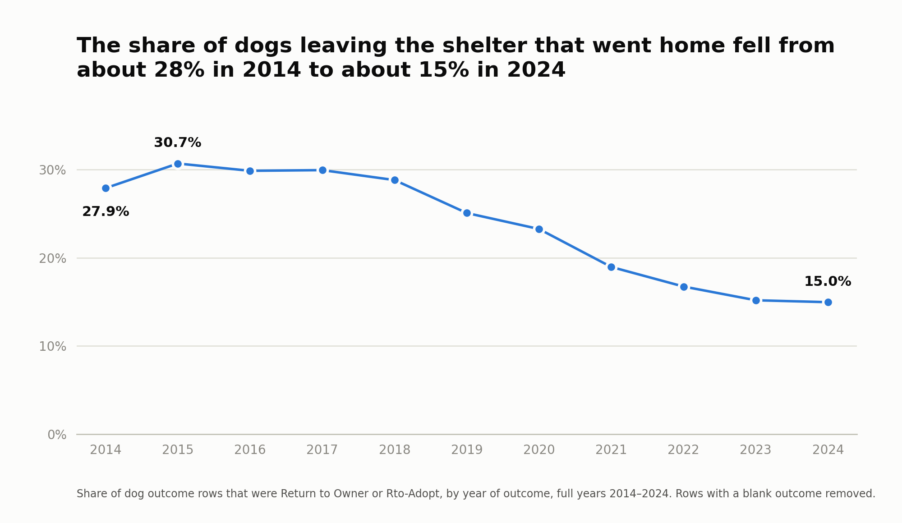
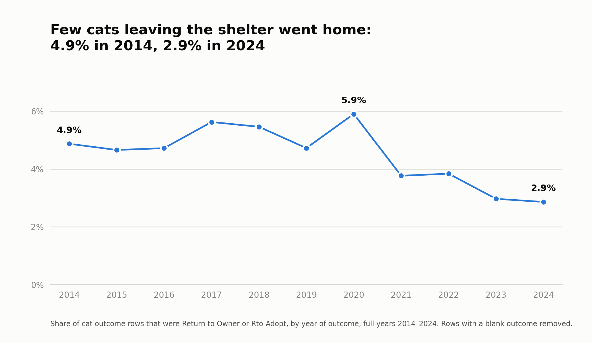

*This project follows a guided walkthrough, which supplied the question, the cleaning rules and the first findings and recommendations; the extension, and the explanation of every line of the code, are my own work.*# austin-shelter-returns# Are fewer dogs going home from the Austin shelter?

**Question.** For a volunteer lead at an animal shelter who runs the lost-pet team (a made-up reader for this project), deciding whether anything has changed in how animals leave the shelter that is worth raising at the planning meeting and what to ask the shelter for next: for dogs and cats, what share of the animals leaving the shelter went home to their owners, has that changed across the full years 2014 to 2024, and what should she ask the shelter for next?

**Answer.** Under our rule, where Return to Owner and Rto-Adopt both count as going home, the share of dogs leaving the Austin Animal Center that went home fell from 27.9% in 2014 to about 15% in 2024, nearly half. For cats the share stayed far below dogs: 4.9% in 2014 and 2.9% in 2024. Across 2014 to 2024 the dog share is about 25% (22,728 of 90,003 rows) and the cat share 4.5%, so the period you pick moves the dog answer by about ten points.

## Recommendations
1. **Raise the fall at the planning meeting.** The share of dogs leaving that went home was 23.3% in 2020, 16.7% in 2022 and about 15% in 2024. It falls whichever way Rto-Adopt is counted. Quote the recent years, not the 2014 to 2024 average of about 25%, which hides about ten points of the fall.
2. **Ask a question about cats, not a claim.** Their share was 2.9% in 2024. This file cannot say why it is low. Question for the meeting: how do lost cats usually get home, if it is not through the shelter?
3. **Ask the shelter for the Intakes file** (https://data.austintexas.gov/d/wter-evkm). The share I measured counts animals their owners surrendered as well as strays, so it cannot tell the two apart. The Intakes file records how animals came into the shelter, about the same size (around 174,000 rows) and also labelled public domain, so getting it next is how you start to separate the strays from the surrenders.

## Limits
- The file covers October 2013 to May 2025. I used the full years 2014 to 2024.
- It records how animals left. It has no columns for how they came in, whether they were microchipped, or what the shelter's policies were. So this measures the share of animals leaving that went home, not the chance a lost pet gets home.
- Rto-Adopt appears only from 2017 and is not defined anywhere I could find. The size of the dog fall depends on it: nearly half if it counts (27.9% to about 15%), more than half if it does not (27.9% to 12.9%). The direction is the same either way.

## My extension
**Question.** [PLACEHOLDER, write your own: your one-sentence question, same dogs and cats, same full years 2014 to 2024.]

**Result.** [PLACEHOLDER, write your own: what you found, with counts and the period. Whatever comes back goes in, even if it is small or not what you predicted.]

**One limit.** [PLACEHOLDER, write your own: what this result can't tell you.]## How I got the numbers
Cleaning decisions (from decision-log.txt):
1. 173,775 rows and 156,237 different animal IDs, so one row is one outcome, not one animal.
2. Names left alone (49,784 blank, 28.6%); the question does not use them.
3. Removed 46 rows with no outcome: 173,729 rows left.
4. Set aside Other, Bird and Livestock: 163,865 dog and cat rows.
5. Went home = Return to Owner or Rto-Adopt (1,241 Rto-Adopt rows), following the City's recent "RTO/RTO Adopt" reporting.
6. Year = first four characters of DateTime.
7. Full years 2014 to 2024 only (2013 and 2025 are partial): 156,201 rows.
8. [PLACEHOLDER, write your own: the log line for your extension, with any new rule and its row count.]

Counting per animal instead of per row barely moves it: dogs 25.4% (25.3% by row), cats 4.6% (4.5% by row). Counting only Return to Owner: dogs 24.0% across all years and 12.9% in 2024 (27.9% in 2014 either way), against 25.1% and about 15% with Rto-Adopt counted.

Cross-check:
- **Spreadsheet:** filtering the raw file to Dog, Return to Owner or Rto-Adopt, 2024 gives 782 rows out of 5,233 dog rows, about 15%.## Rerun it
1. Data: Austin Animal Center Outcomes (the historical file, October 2013 to May 2025), City of Austin Open Data Portal: https://data.austintexas.gov/d/9t4d-g238. The portal labels it public domain and asks for credit to the City of Austin and the department that publishes it (Austin Animal Center). That is the publisher's statement, not legal advice. [confirm exact wording on the dataset page] Do not use the newer dataset with the same name (it starts May 2025).
2. On the dataset page, click Export, then CSV. Rename the download to `austin_outcomes.csv`.
3. Put it in the same folder as `analysis.py` and run `python analysis.py` (needs Python with pandas and matplotlib; in Google Colab: upload both files, then run `!python analysis.py`).
4. You should get `dogs_went_home.png` and `cats_went_home.png`, plus any chart your extension adds, and the printed row counts 173,775, 173,729, 163,865 and 156,201.

Code written and run with Claude.
